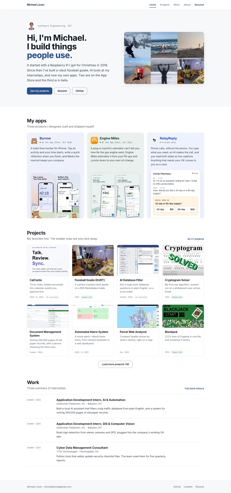
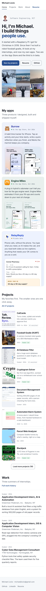
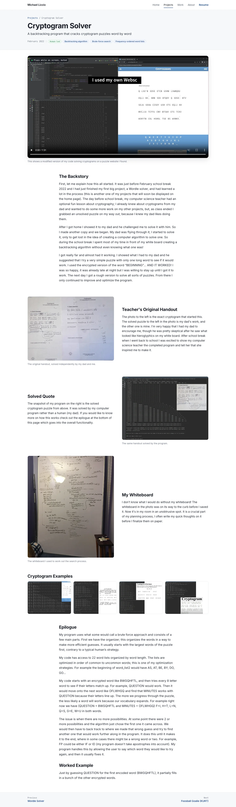
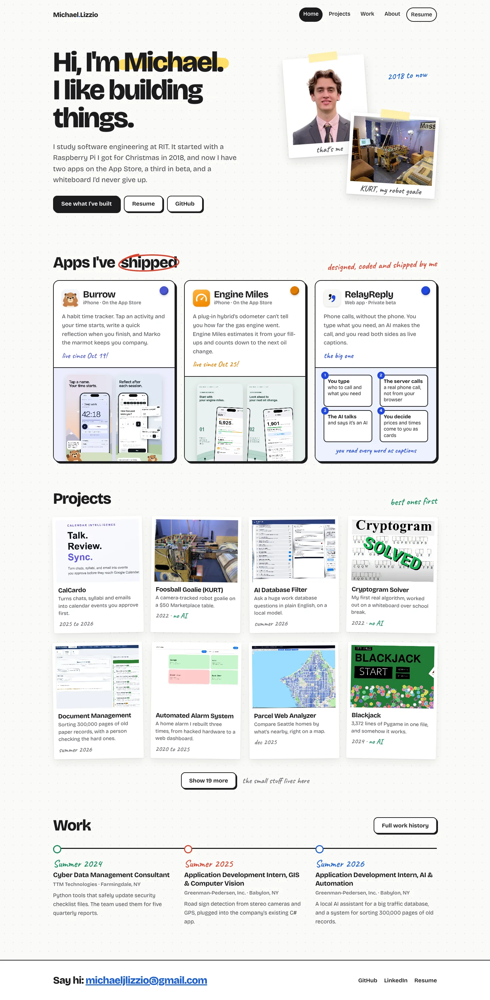
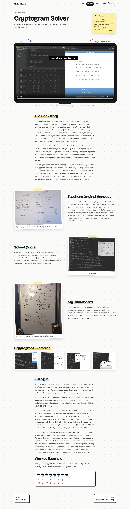
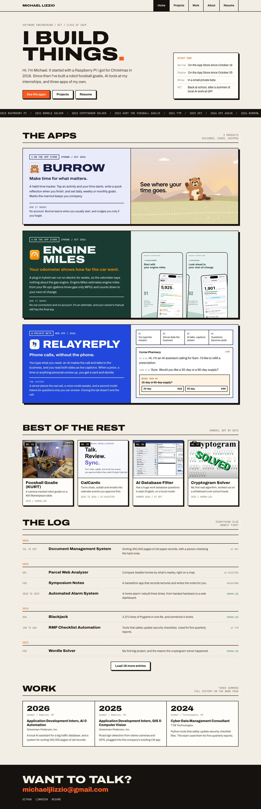
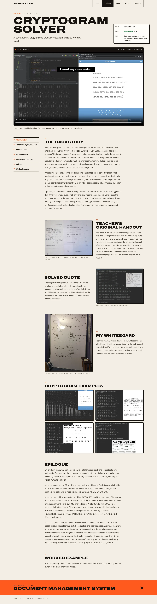

# Look directions, November 2026

Three looks for the portfolio refresh. Each one is a static HTML mockup of the **home page** and **one project page** (the Cryptogram Solver, because it has the new video behavior). Nothing in `src/` has changed. Michael picks a look, then it gets built into the real site.

| | A. Tidy | B. Whiteboard | C. Build Log |
| --- | --- | --- | --- |
| How far from today | Close. Same fonts, same blue | Medium. New fonts, warm marker accents | Far. Bold type, thick outlines, colored panels |
| Feel | Calm, clean, professional | Friendly, personal, a bit playful | Loud, confident, "product launch" |
| Best at | Looking finished without risk | Sounding like you | Showing off the three apps |
| Risk | Still looks like a lot of dev portfolios | The handwritten notes get cute if overused | Trendy look, can feel designed by someone else |
| Work to build | Small (about a day on top of the content work) | Medium (2 to 3 days) | Medium to large (3 to 4 days) |

**My lean: B, Whiteboard.** Reasons below.

## How to open them

Open the HTML files from a checkout of this branch (they load images from `content/projects/` and `public/images/`, so they only work inside the repo):

- `docs/directions/a-tidy/home.html` and `project.html`
- `docs/directions/b-whiteboard/home.html` and `project.html`
- `docs/directions/c-buildlog/home.html` and `project.html`

The screenshots are in `shots/`, at 1440 px wide and 390 px wide (iPhone size, rendered at 2x with mobile emulation). None of the pages scroll sideways at 390.

## What all three share

These are structure changes. They apply whichever look you pick.

- **Nav:** Home, Projects, Work, About, Resume. "Work" is now the job history page, and "Projects" is what used to be called Work.
- **Your three apps come first.** Burrow and Engine Miles are shown as live on the App Store, and RelayReply as a private beta. RelayReply gets a small picture of the calling system (you type, the server calls, the AI talks, questions come back as cards) so a visitor gets the idea without technical detail.
- **Projects are ranked, best first.** About 8 are visible, and the rest sit behind a "Load more" button. The order in the mockups follows the audit ranking: CalCardo, KURT, AI Database Filter, Cryptogram, then Document Management, Alarm System, Parcel Web Analyzer, Blackjack and so on. The weak ones you named (fun page, trip planner, RIT dining, laundry tracker, Roman numerals, rock paper scissors, Tic Tac Toe) are all behind the button.
- **A short Work section on the home page** (the three summers), linking to the full Work page.
- **Cryptogram page:** the webpage-only video is gone. The video of your code solving puzzles moves to the top of the page and is shown at full page width (about 1150 px instead of 720 px). It plays muted when at least half of it is on screen and pauses when you scroll away. Controls stay on. People who set "reduce motion" on their device only get the poster image. The mockups contain the working script.
- **Your words stay exact.** The cryptogram text and captions in all three project pages are filled in by a script straight from `content/projects/cryptogram/project.json`, and I checked every paragraph and caption against the file. The text sections keep their order, so "the photo to the left", "the solved cryptogram puzzle from above" and "the epilogue at the bottom of this page" are still true. The only move is the video, which goes up to the top. The summary paragraph is left out, because it is AI-written and talks about "the author". It needs your OK before it is rewritten.
- **Everything else is a stand-in.** The hero intro, app blurbs and one-line project descriptions are short drafts I wrote so the layouts have real-length text. The copy pass replaces them with the final wording.
- **No em dashes** anywhere in these files.
- **Matching the content branch.** The copy and structure work on this branch (see `docs/REFRESH-NOV-2026.md`) keeps Contact in the nav, shows 12 projects before "Load more" and writes "Greenman Pedersen" without the hyphen. The mockups show 8 projects and leave Contact out to keep the screenshots short. Every look handles 12 cards and a sixth nav link without changes. The mockups' ranking and counts are only examples. `src/lib/project-order.ts` sets the real ones.

---

## A. Tidy

**The idea.** The current site, cleaned up. It keeps Inter, the navy blue and the white and light-grey surfaces, so it still feels like your site, just more finished. The hero says hi in your voice instead of a resume objective. The three apps get soft-tinted cards in each app's own color, which adds some life without changing the brand. Cards have fixed 4:3 images, no tech pills and simple dates ("2025 to 2026", "Summer 2026"). The project page puts the big video right under the title, and the photo and text rows now line up on one grid (today the headings jump between a wide and a narrow column).

| Home, phone | Cryptogram page | Cryptogram page, phone |
| --- | --- | --- |
|  |  |  |

**What it changes in the real site**
- `globals.css`: no token changes. Adds three soft app tints (Burrow, Engine Miles and RelayReply colors from the TooAvid site).
- `src/app/page.tsx`: new hero copy, an apps section, a ranked projects grid with "Load more", and a work teaser.
- `ProjectCard.tsx`: fixed 4:3 image with a crop point, drops the tech pills, shorter date format.
- `MediaFigure.tsx`: an opt-in "autoplay in view" mode for video, plus a full-width feature slot at the top of the project page.
- Project page layout: headings sit inside the text column on media rows.

## B. Whiteboard

**The idea.** Your whiteboard is already in your own story ("I don't know what I would do without my whiteboard!"), so the site borrows it. The page is an off-white board with a faint dot grid, and the headings are big and friendly (Bricolage Grotesque). A few short notes are written in marker (Caveat): "that's me", "KURT, my robot goalie", "live since Oct 19!", "best ones first". Photos are taped up like prints, projects are snapshot cards tilted a degree or so, and the app cards hang with a colored magnet in each app's color. The project page shows the video inside a monitor frame, with marker arrows labeling "my code" and "the puzzle website". Section titles get a highlighter swipe, and the worked example becomes a small hand-drawn cipher sketch (BWGQHFTL over QUESTION). Body text stays in a plain, readable font. Only the short notes are handwritten.

| Home, phone | Cryptogram page | Cryptogram page, phone |
| --- | --- | --- |
|  |  |  |

**What it changes in the real site**
- Fonts: Bricolage Grotesque for text and Caveat for notes, both loaded with `next/font/google` in `layout.tsx`. These replace Inter and JetBrains Mono.
- `globals.css`: new tokens for the board, ink and three marker colors (blue, red, green) plus a highlighter yellow. Dark mode becomes a "chalkboard" version (dark slate with the same marker colors), which still has to be designed.
- New small pieces: `Note` (a handwritten annotation, at most 4 per page), `Taped` (a photo frame with tape) and `Highlight` (the heading swipe).
- Cards: polaroid style with a slight tilt that straightens on hover. The tilt is turned off for reduced motion.
- `content` schema: an optional `note` field per project (the marker line on its card, such as "no AI").
- The same video and ranking changes as A.

## C. Build Log

**The idea.** The site reads like a launch page plus a lab notebook. The type is big and wide (Archivo Expanded, all caps), with thick black outlines, hard offset shadows and one hot orange on warm paper. "I BUILD THINGS." fills the hero, and next to it a "Right now" box says what is live. A ticker runs your timeline from the 2018 Raspberry Pi to the 2026 apps. Each app gets a full-width panel in its own colors (lavender Burrow with Marko, dark green Engine Miles, blue RelayReply with the call system and a live-call card). After that come "Best of the rest" (numbered No. 04 to 07) and "The log", which lists everything else by year like a build log, with a "Load more" button. The project page has a big "screen" for the video, a sticky section index on the left on desktop, and a bright "Next project" bar at the bottom.

| Home, phone | Cryptogram page | Cryptogram page, phone |
| --- | --- | --- |
|  |  |  |

**What it changes in the real site**
- Fonts: Archivo (a variable font with a width axis, used wide for headings and normal for text) plus JetBrains Mono for labels. Inter is dropped.
- `globals.css`: a whole new token set (paper, ink, hot orange, 2.5 px borders, offset shadows). The current one-accent rules would be replaced. Dark mode needs its own design.
- New pieces: `AppPanel` (one per app, using that app's palette), `Ticker`, `LogEntry` grouped by year, and `SectionRail` (a sticky in-page index).
- The project page gets a new layout with a rail and numbered sections. The section numbers come from the order in the JSON, so no wording changes.
- Ranking numbers ("No. 07") are shown publicly. This needs a `rank` field in the schema, and it also makes the order visible, which you may not want.

---

## Why I lean B

1. **It's the only one that is about you.** A and C would fit anyone's portfolio. B uses things from your own pages: the whiteboard, the taped-up handout, KURT on the table, your dad's and your handwriting on the puzzle. The marker notes sound like your writing (short, plain, a bit excited).
2. **It's fun without being loud.** The playful bits are small: a few notes, a slight tilt and a highlighter. Long text like the cryptogram epilogue still reads like a normal page.
3. **The apps still stand out.** Each app card has its own color, real screenshots and a one-line status.
4. **It holds up with photo-heavy pages.** KURT's build log and the cryptogram photos look like they belong on a board.

Take **A** if you want the lowest risk and the fastest ship. Take **C** if the main goal is impressing people with the apps (recruiters, possible users), since it presents products best, but it reads more "agency" than "Michael".

One mix that would work: B for the whole site, with C's full-width app panels instead of B's three app cards. I would not mix any further than that.

## Decisions for Michael

1. **Which look:** A, B or C (or B with C's app panels)?
2. **Handwritten notes (B only):** are you OK with a few marker notes in a script font? I wrote them as placeholders, and you can replace them with your own.
3. **Show ranking numbers?** C shows "No. 04" on cards. A and B rank silently (best first, with no numbers).
4. **Apps:** should the cards link to each app's own page on this site (my lean, so people stay here and read the story) or straight to the App Store or app websites? I left prices off on purpose, because they change and would go stale.
5. **Company name spelling:** the mockups use "Greenman-Pedersen, Inc." (the firm's official spelling, with the hyphen). The resume has no hyphen. Pick one and use it everywhere.
6. **Photo of you:** A and B use the suit headshot. A more casual photo (skiing or the beach shots from the collage) would suit B better.

## Facts used

- Burrow live on the App Store since October 19, 2026 and Engine Miles since October 25, 2026, from each repo's `HANDOFF.md`. The TooAvid site still says beta and TestFlight, so it is out of date.
- RelayReply is in a private beta (the facts file says "not posting yet"). The example call is the Corner Pharmacy demo from the TooAvid site. It says it is an AI, which matches the default behavior.
- Engine Miles wording follows `engine_miles.yaml`: it is an estimate, there is no car connection, and the owner's manual has the final say.
- App icons and screenshots are copied from the TooAvid site (`assets/`). Fonts are bundled in `fonts/` (open-licensed Google Fonts, Latin subset) so the mockups render offline.
